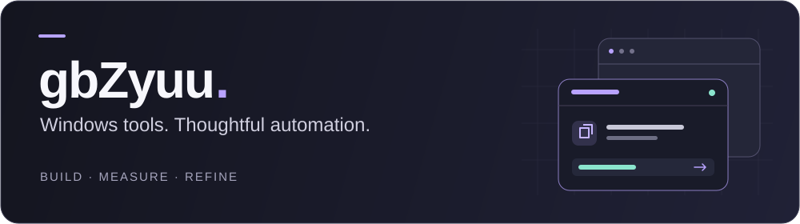

  

<h1 align="center">Tools for the way you work.</h1>

  I build Windows applications, automation and integrations. 
  Clear interfaces up front. Measured behavior underneath.

  <a href="#featured-projects">Explore projects</a> &nbsp; / &nbsp;
  <a href="https://github.com/gbZyuuu?tab=repositories">All repositories</a> &nbsp; / &nbsp;
  <a href="#português">Leia em português</a>

 

## Featured projects

### 01 / MultiJanela

**Your accounts, sessions and windows. One place.**

A Windows desktop manager for Roblox with a unified account view, ordered launch
queues and named destinations. See each session's PID, client version and uptime;
arrange windows and manage running sessions from the same screen.

**Windows x64** · C# / .NET 8 / WPF · English + Português · MIT

[**Download for Windows →**](https://github.com/gbZyuuu/MultiJanela/releases/latest)
&nbsp; [Source & guide](https://github.com/gbZyuuu/MultiJanela)
&nbsp; [Compatibility notes](https://github.com/gbZyuuu/MultiJanela/blob/main/docs/TECHNICAL.md)

Independent and unofficial. Multi-instance handling and version pinning change normal Roblox client behavior and can carry account-moderation risk. Read the compatibility notes before using it.

 

### 02 / Codex Account Manager

**Your subscriptions, without the guesswork.**

See the usage limits and reset times reported for your Codex subscriptions inside
the account menu. Switch accounts in one click and return to your conversation.
The active account's available quota also stays visible beside the composer.

  

**Windows** · JavaScript / Electron / Node.js · English + Português

[**Installation & guide →**](https://github.com/gbZyuuu/codex-account-manager#install)
&nbsp; [Source](https://github.com/gbZyuuu/codex-account-manager)
&nbsp; [License](https://github.com/gbZyuuu/codex-account-manager/blob/main/LICENSE)

Independent project, not affiliated with OpenAI. The preview uses fictional accounts. Free to use and share under the project's license.

 

## Behind the tools

I work with **Windows desktop applications**, **Lua automation** and **Node.js
services**. Applied reverse engineering helps me understand existing software;
state machines, resource ownership and failure recovery help me build around it.

| Focus | What I care about |
| :--- | :--- |
| Interface | Readable information, clear actions and fewer unnecessary steps. |
| Reliability | Explicit state, bounded work and useful diagnostics. |
| Verification | Reproducible checks, recorded evidence and honest limitations. |

**Desktop** &nbsp; C# · .NET · WPF · Electron 
**Automation & services** &nbsp; Lua · JavaScript · Node.js · Python · PowerShell 
**Also work with** &nbsp; Java · Git

 

## Português

**Ferramentas para o seu dia a dia.** Desenvolvo aplicativos para Windows,
automações e integrações, com interfaces claras e comportamento verificado.

- **[MultiJanela](https://github.com/gbZyuuu/MultiJanela):** contas e sessões do
  Roblox em uma só tela, com PID, versão e tempo ativo. Fila de abertura ordenável,
  destinos salvos e organização de janelas. Inglês e português, com troca imediata.
  [Baixar para Windows](https://github.com/gbZyuuu/MultiJanela/releases/latest).
  Projeto não oficial, com risco de moderação da conta; leia as
  [notas de compatibilidade](https://github.com/gbZyuuu/MultiJanela/blob/main/docs/TECHNICAL.md).
- **[Codex Account Manager](https://github.com/gbZyuuu/codex-account-manager):**
  cotas e horários de renovação das assinaturas no menu de conta, troca em um
  clique e retorno à conversa. Indicador de cota junto ao campo de mensagem.
  [Instalação e uso](https://github.com/gbZyuuu/codex-account-manager#instalação).
  Projeto independente, sem afiliação à OpenAI.

Trabalho com aplicações desktop, automação em Lua e serviços em Node.js.
Priorizo legibilidade, recuperação de falhas e evidências reproduzíveis.

---

  Measure, record, then conclude. &nbsp; · &nbsp; Medir, registrar, depois concluir.

